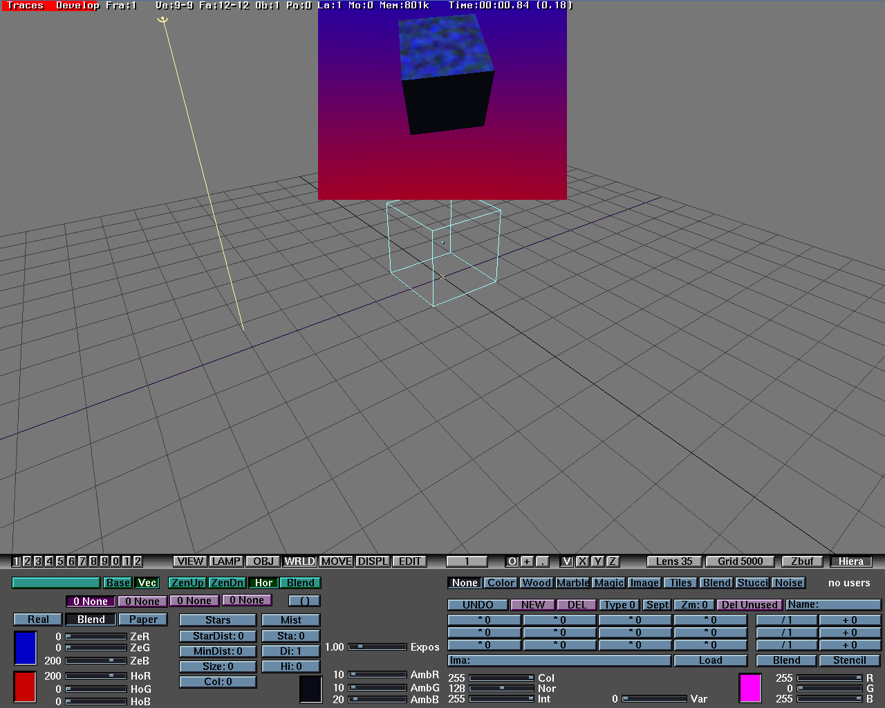

# Traces

Traces is an ancient in-house 3D modeling, animation, and ray tracing software from the '90, developed by the Dutch animation studio NeoGeo. Later this software become [Blender](https://www.blender.org/).

Originally develop for Commodore Amiga, this software was later ported to Silicon Graphics workstation.

Source code and some compiled binaries originally released on [Official Blender source code archive](https://download.blender.org/source/chest/) in file `neogeo.tar.gz`.

The IRIX binaries from `neogeo.tar.gz` required `libimbuf.so` and `libimage.so` that didn't included in the tarball. While the source code for `libimbuf.so` did included, it's makefile require `libimbuf.so` to build, which are circular dependency problem.
I have untangle that problem and found it only used for building `make_convert` to generate `convert_arrays.h`, which `convert_arrays.h` is already included in the source code tarball.

For `libimage.so`, it is dynamic library version of `libimage.a`, which can be install from IRIX 5.3 IDO and can just link it to a dynamic library.

Note that the original Traces executable is compiled on IRIX 6.2 and some code do required IRIX 6.2 to compile.

Some changes to the source code other than to make the source code compile:

- Update jpeg library from v6a to v6b.
- Re-enable IGES and Cyberware Digitizer Data support.

  In IGES code, `DL_POINT` type is not exist, even in newer version of blender. I have assign it as `DL_SEGM` as a guess.

# Building the source code on IRIX 5.3

**TODO: Chroma, render-gui, play and play-gui program required XForms Toolkit v0.86, as the source code of old v0.8x is not available, replace it with v1.0.2 (required libxpm on IRIX 5.3).**

**TODO: see to the hard coded paths in various places.**

Currently compile with `-mips2` flags, which the result binary will required R4000 CPU.

To compile for R3000 CPU, change `CFLAGS` variable in all `makefile` from `-mips2` to `-mips1` and rebuild all source code.

- Install IRIX 5.3 IDO
- Install Impressario 1.2 Developer's Kit (optional, for compile `newstiff` program)
- Open a terminal and change directory to `src/imbuf/`
- `make`
- Copy `libimbuf.so` and `libimbuf.a` to `/usr/lib/`
- `cd ../libimage`
- `make`
- Copy `libimage.so` to `/usr/lib/`
- `cd ../traces`
- `make`
- `cd ..`, the current directory will be at `src/`
- `make`
- Compiled executable will go to `bin-irix-mips2`, copy the executable to `/usr/people/bin/`

# Install directory layout

This was the directory layout that I used while fixing and compiling Traces on IRIX.

    /usr/people/bin/                    binaries go here
    /usr/people/blend/                  copy blenderbuttons here (if Blender 1.0 installed)
    /usr/people/khral/traces/           this repo
    /usr/people/khral/traces/scenes/    sample scene from Traces Amiga version
    /usr/people/khral/traces/src/       trace source code from this repo

# How to use Traces

    F1              load scene
    F2              save scene
    Q               quit
    Shift + A       popup menu
    Space           popup menu
    Tab             enter/exit edit mode
    G               grab
    R               rotate
    S               scale
    Z               solid view
    Numpad Keys     3D viewport mode select

# Information about Traces

[TRACES - The beginnings of Blender](https://www.youtube.com/watch?v=_WH0arC4cDw) on SGI Indy

[Traces, Blender from 1995](https://www.youtube.com/watch?v=wreHFveYdDg) on SGI Indy

[Traces (Amiga version) on GitHub](https://github.com/Endertainer007/Traces_Amiga)

[Blender's prehistory — Traces on Commodore Amiga (1987–1991)](https://zgodzinski.com/blender-prehistory/)

[Traces (Blender's Predecessor)](https://www.youtube.com/watch?v=glhi_l2VDVE) on Amiga

[Traces Tutorial - Blender Bach](https://www.youtube.com/watch?v=zKn8qjgG1YA) on Amiga

# Some unused source code files

    src/
    hidline.c                   IRIS GL hidden lines demo
    kramer.c                    experimental code?
    mcast.c                     program demonstrates how to send and receive UDP multicast
    mpegdec.c                   unfinished code
    ontwikkel.c                 video and disk related benchmark code
    ontwikkel3.c                video and disk related benchmark code
    osview.c
    test.c                      experimental code
    vfrutil.c                   Video Framer utility

    src/playstation_engine      NeoGeo's in-house Sony Playstation game engine

    src/traces/
    brender.c                   unfinished code
    makeblender.c               binary edit compiled Traces in to Blender
    oud.c                       experimental code
    performance.c               CPU benchmark code
    psfont405.c                 psfont.c for IRIX 4.0.5
    rt.c                        for testing Normalise function
    stars.c                     make_stars function
    tab.c                       for testing makekeytab function
    test.c                      for testing qsortN2 function
    verditSort.c                older or experimental? version of verdit.c

    src/unused
    Fs*.c, Fs*.h                unfinished file selector, FORMS library version
    pluginrgb.c                 Blender plugin
    plugintex.c                 Blender plugin

    src/unused/ton
    calcika.c
    calcikan.c
    dev3d.c                     Blender experimental code
    dyna.c                      dynamic experimental code
    fade.c                      gammaramp experimental code
    ika3d.c
    inbetween.c                 unfinished code
    Objbuts.c                   shade sphere demo?
    Paint.c                     unfinish? new version of paint program
    readblender.c               read Blender file
    tunnel.c                    tunnel graphic demo
    viewika.c
